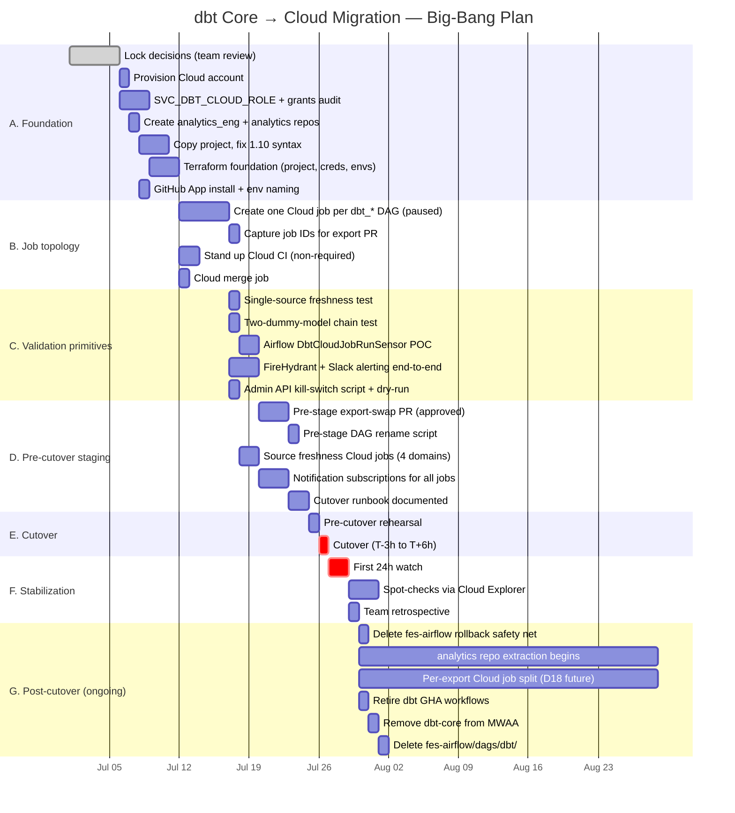
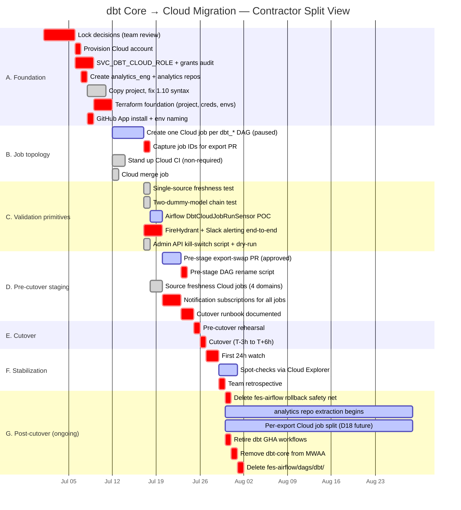
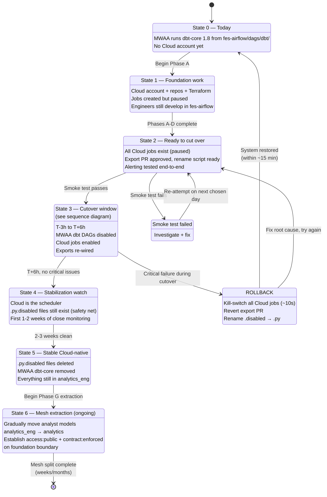
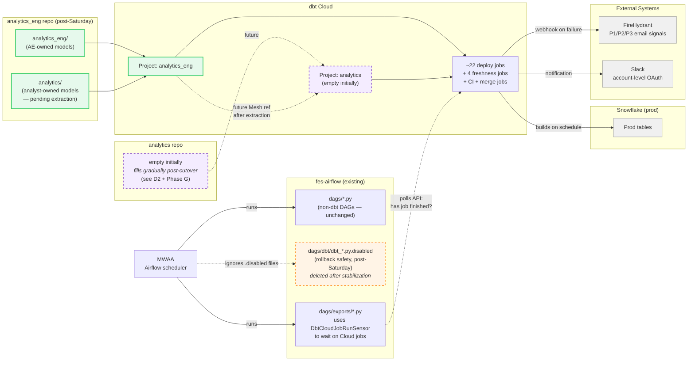

# Migration Visualizations — Big-Bang Plan

Mermaid sources. Paste each into a Confluence **Mermaid Diagram** macro (or any Mermaid-rendering viewer — GitHub, Obsidian, VS Code, mermaid.live).

Start dates and durations are placeholders. Adjust once the team picks a Saturday.

---

## 1. Phase timeline (Gantt)

Best for: showing the calendar shape — 5-6 weeks foundation → Saturday cutover → 1 week stabilization → ongoing extraction.



---

## 1b. Phase timeline (Gantt) — contractor split view

Same Gantt as above, but color-coded by who could reasonably own each item if we bring in a dbt Labs consultant.

**Legend** (using Mermaid Gantt tag semantics as a proxy for color):
- `done` → 🟢 **Pure dbt** (contractor owns end-to-end, ~11 pts)
- `active` → 🔵 **Contractor reasonable with support** (contractor codes, we deploy, ~29 pts)
- `crit` → 🔴 **We do ourselves** (internal access / context / on-call ownership, ~30 pts)



### Category breakdown

| Category | Items | Points | % of total |
|---|---|---|---|
| 🟢 Pure dbt (contractor owns) | 7 | 11 | 15% |
| 🔵 Contractor reasonable (paired) | 6 | 29 | 41% |
| 🔴 We do ourselves | 19 | 30 | 42% |
| **Total** | **32** | **70** | 100% |

### Pre-cutover only (Phases A–E)

If contractor engagement ends at cutover:

| Category | Points to cutover | % |
|---|---|---|
| 🟢 Pure dbt | 11 | 24% |
| 🔵 Contractor reasonable | 10 | 22% |
| 🔴 We do ourselves | 24 | 53% |
| **Total pre-cutover** | **45** | 100% |

**Read:** a dbt Labs consultant could take ~11 pts (24%) fully off our plate, and pair with us on ~10 pts (22%) more — up to 46% of pre-cutover work externalized. The remaining 53% requires internal access or org context.

### What falls where

**🟢 Pure dbt (contractor owns):**
- Copy project + fix 1.10 syntax (a5)
- Stand up Cloud CI (b3)
- Cloud merge job (b4)
- Single-source freshness test (c1)
- Two-dummy-model chain test (c2)
- Admin API kill-switch script (c5)
- Source freshness Cloud jobs (d3)

**🔵 Contractor reasonable (needs some access / pairing):**
- Create Cloud jobs — needs Terraform access, but design is dbt pattern (b1)
- Airflow DbtCloudJobRunSensor POC — needs fes-airflow access (c3)
- Pre-stage export-swap PR — needs to understand our 6 export DAGs (d1)
- Post-cutover spot-checks — needs Snowflake read access (f2)
- analytics repo extraction — Mesh is a dbt Labs strength, but needs domain judgment (g2)
- Per-export Cloud job split — pure dbt pattern, needs our deploy access (g3)

**🔴 We do ourselves (internal only):**
- All decision-making (a1)
- Cloud account provisioning + billing (a2)
- Snowflake role + grants (a3)
- GitHub repo creation + CODEOWNERS (a4)
- Terraform authoring (a6)
- GitHub App install (a7)
- Capture job IDs from our TF (b2)
- FireHydrant + Slack integration — our internal systems (c4)
- DAG-rename PR in fes-airflow (d2)
- Priority mapping to FireHydrant P1/P2/P3 (d4)
- Cutover runbook — our on-call, our contacts (d5)
- Rehearsal + cutover + watch (e1, e2, f1)
- Team retrospective (f3)
- All fes-airflow cleanup (g1, g4, g5, g6)

---

## 2. Cutover sequence (T-3h to T+6h)

Best for: the cutover runbook itself — what happens, in what order, who does what, with explicit rollback branches.

```mermaid
sequenceDiagram
    autonumber
    actor Eng as Engineer (on-call)
    participant FA as fes-airflow / MWAA
    participant TF as Terraform / Job mgr
    participant DC as dbt Cloud
    participant SF as Snowflake
    participant FH as FireHydrant + Slack

    rect rgb(255, 244, 230)
        Note over Eng,FH: T-3h — Smoke test
        Eng->>DC: Trigger all jobs into shadow schema<br/>(DATABASE_OUTPUT_OVERRIDE)
        DC->>SF: Build models in shadow
        SF-->>DC: Build results
        DC-->>Eng: All green? ✅ proceed / ❌ abort + reschedule
    end

    rect rgb(230, 244, 255)
        Note over Eng,FH: T-30m — Final pre-checks
        Eng->>FA: Confirm last Airflow dbt_* runs completed
        FA-->>Eng: ✅ clean
        Eng->>FH: Page on-call coverage active
    end

    rect rgb(230, 255, 244)
        Note over Eng,FH: T0 — Cutover
        Eng->>FA: Merge rename PR<br/>(dbt_*.py → .disabled)
        FA->>FA: MWAA picks up rename<br/>(~15 min)
        FA-->>Eng: dbt_* DAGs no longer visible
    end

    rect rgb(230, 255, 244)
        Note over Eng,FH: T+30m — Enable Cloud
        Eng->>TF: Flip all Cloud jobs paused=false
        TF->>DC: Apply
        DC-->>Eng: Jobs active on their crons
    end

    rect rgb(230, 255, 244)
        Note over Eng,FH: T+45m — Wire exports
        Eng->>FA: Merge export-swap PR<br/>(DbtCloudJobRunSensor)
        FA->>FA: Export DAGs now poll Cloud
    end

    rect rgb(230, 255, 244)
        Note over Eng,FH: T+1h — Smoke test on prod
        Eng->>DC: Manually trigger one job
        DC->>SF: Build into real prod
        SF-->>DC: ✅
        DC->>FH: Notification subscriptions fire (none, since success)
    end

    Note over Eng,FH: T+1.5h to T+6h — Hands off, watch
    DC->>SF: Scheduled runs fire normally
    DC->>FH: Any failures route to FH/Slack
    Eng->>DC: Spot-check Cloud Explorer + Discovery API

    alt ❌ Critical failure detected
        Note over Eng,FH: ROLLBACK
        Eng->>Eng: Run kill-switch script<br/>(Admin API pauses all jobs ~10s)
        DC-->>Eng: All jobs paused
        Eng->>FA: Revert export-swap PR
        Eng->>FA: Rename .py.disabled → .py
        FA->>FA: MWAA picks up; dbt_* DAGs back live
        Note over Eng,FH: System back to pre-cutover within ~15 min
    else ✅ Stable
        Note over Eng,FH: Cloud is now the scheduler.<br/>Next: Phase F stabilization watch.
    end
```

---

## 3. System-level migration state machine

Best for: explaining "where are we in the migration?" — single state describes the whole system, not per-DAG.



---

## 4. Repo topology + data flow

Best for: explaining "where does dbt code live" before, during, and after the migration. Same shape as before, updated to reflect big-bang and analytics-empty-initially.



---

## How to embed in Confluence

1. Edit the target page.
2. Type `/mermaid` and select the **Mermaid Diagram** macro (or the **Mermaid Chart for Confluence** app if installed).
3. Paste one of the code blocks above (content between the ` ```mermaid ` and ` ``` ` markers — not the markers themselves).
4. Save.

If your space doesn't have a Mermaid macro, use the **draw.io / Diagrams** macro and import via "Edit Diagram → Insert from Text → Mermaid".

## How to evolve

When the plan changes (e.g., D18 split lands, D19 mechanism locks):
- Update the relevant Mermaid block in this file
- Re-paste into Confluence
- Or — if your Mermaid Confluence app supports it — point the macro at this Git file for live rendering

For executive presentations, use these as the structural sketch and let a designer style them in Lucid.
