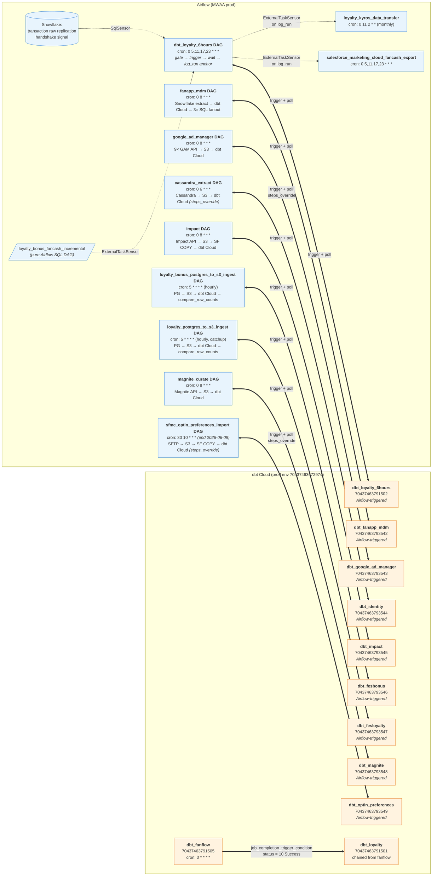

# Post-Cutover Architecture — Airflow ↔ dbt Cloud

Updated 2026-07-19 (§5.1 of [`dbt-in-airflow-removal.md`](dbt-in-airflow-removal.md)) to reflect the 9 Airflow→dbt Cloud handshakes: `dbt_loyalty_6hours` (unchanged, D41-canonical) plus the 8 ingest-coupled DAGs migrated in commit `b91ecdb3` (`fanapp_mdm`, `google_ad_manager`, `cassandra_extract`, `impact`, `loyalty_bonus_postgres_to_s3_ingest`, `loyalty_postgres_to_s3_ingest`, `magnite_curate`, `sfmc_optin_preferences_import`).

Snapshot of the operational relationships between Airflow (MWAA prod) and dbt Cloud immediately after the cutover button is pushed.

**Scope**: only cross-system relationships. Pure Airflow DAGs (Snowflake → SFTP with no dbt Cloud interaction) and pure dbt Cloud cron jobs (no Airflow interaction) are intentionally omitted from the main diagram; they'd add noise without adding signal. A summary table at the bottom lists all 22 dbt Cloud jobs and how each is triggered.

**As-of**: cutover day. Fangraph is intentionally paused at cutover — its downstream Airflow/xtremepush link is not active yet, so it doesn't appear here.

**D42 conditional**: this diagram shows the **single-project** post-cutover state. If D42 (analytics project split, see [`analytics-project-split.md`](analytics-project-split.md)) completes pre-cutover, `dbt_users` moves out of the AE project and into a NEW dbt Cloud project pointing at `dbt-fes-analytics`. Since `dbt_users` has no Airflow interaction (per D41), the split adds a second `dbt Cloud` subgraph but no new cross-system edges. Table below documents the AE-side and analytics-side jobs distinctly.

---

## Legend

| Arrow | Meaning |
|---|---|
| `-.->` (dashed) | sensor / gating dependency — one thing waits on another |
| `==>` (thick) | trigger / active invocation |
| `<==>` (thick, bidir) | trigger + poll (Airflow POSTs a run, then polls until complete) |

---

## Main diagram

## How to read it

**Cross-system relationships:**

1. **9 Airflow → dbt Cloud trigger+poll handshakes**: `dbt_loyalty_6hours` (loyalty pipeline) plus 8 ingest-coupled DAGs. Each uses `DbtCloudRunJobOperator` to POST `/run/`, then `DbtCloudJobRunSensor` polls until the run reaches a terminal state, then `log_run` anchors any downstream sensors.
   - `cassandra_extract` and `sfmc_optin_preferences_import` pass `steps_override=[...]` at trigger time to thread `data_interval_start` / `data_interval_end` / `ds_nodash` into `dbt build --vars` (their model sets consume those vars).
2. **`dbt_loyalty_6hours` downstream sensors**: `loyalty_kyros_data_transfer` and `salesforce_marketing_cloud_fancash_export` each `ExternalTaskSensor` on `dbt_loyalty_6hours.log_run` — they wait until the Cloud dbt run has completed before starting their SFTP exports.
3. **Ingest-DAG upstream sensors**: `dbt_loyalty_6hours` gates on both a SqlSensor (transaction raw replication) and an ExternalTaskSensor on `loyalty_bonus_fancash_incremental`. The 8 ingest-coupled DAGs have per-DAG upstream ingest logic that predates the dbt task-group.

**Intra–dbt-Cloud chains** (no Airflow involvement):

4. **`dbt_fanflow` → `dbt_loyalty`** via `job_completion_trigger_condition` (status = 10 Success). Only surviving dbt-to-dbt chain — every other dbt→dbt dependency runs via its own cron.

**Everything else in dbt Cloud** runs on its own cron with no Airflow involvement (see table below).

---

## dbt Cloud job trigger sources (all 22 jobs)

Full ID + selector registry in [`deploy-jobs.md`](deploy-jobs.md); this table shows only the trigger source (what wakes the job up) so you can see the shape at a glance.

**AE project** (`dbt-fes-ae` → dbt project `fes_data`, project ID `70437463666576`):

| Job | Prod ID | Triggered by |
|---|---|---|
| `dbt_loyalty_6hours` | `70437463791502` | **Airflow** DAG only (no cron) |
| `dbt_fanapp_mdm` | `70437463793542` | **Airflow** `fanapp_mdm` DAG (no cron) |
| `dbt_google_ad_manager` | `70437463793543` | **Airflow** `google_ad_manager` DAG (no cron) |
| `dbt_identity` | `70437463793544` | **Airflow** `cassandra_extract` DAG (no cron; steps_override for data_interval) |
| `dbt_impact` | `70437463793545` | **Airflow** `impact` DAG (no cron) |
| `dbt_fesbonus` | `70437463793546` | **Airflow** `loyalty_bonus_postgres_to_s3_ingest` DAG (no cron) |
| `dbt_fesloyalty` | `70437463793547` | **Airflow** `loyalty_postgres_to_s3_ingest` DAG (no cron) |
| `dbt_magnite` | `70437463793548` | **Airflow** `magnite_curate` DAG (no cron) |
| `dbt_optin_preferences` | `70437463793549` | **Airflow** `sfmc_optin_preferences_import` DAG (no cron; steps_override for data_interval) |
| `dbt_loyalty` | `70437463791501` | **Chain** from `dbt_fanflow` (fallback: hourly cron) |
| `dbt_fanflow` | `70437463791505` | Cron `0 * * * *` (hourly) |
| `dbt_hourly` | `70437463791506` | Cron `0 * * * *` |
| `dbt_daily` | `70437463791507` | Cron `0 12 * * *` |
| `dbt_daily_9am` | `70437463791508` | Cron `15 13 * * *` |
| `dbt_every_3hours` | `70437463791509` | Cron `0 */3 * * *` |
| `dbt_every_6hours` | `70437463791510` | Cron `30 0,1,6,12,18 * * *` |
| `dbt_weekly` | `70437463791511` | Cron `0 10 * * 1` |
| `dbt_meta_ads` | `70437463791512` | Cron `0 8 * * *` |
| `dbt_ltv` | `70437463791513` | Cron `0 12 * * *` |
| `dbt_mde` | `70437463791514` | Cron `45 11 * * *` |
| `dbt_fanapp_recs` | `70437463791515` | Cron `0 12 * * *` |
| `dbt_enterprise_metrics` | `70437463791516` | Manual / ad-hoc (no cron) |
| `dbt_enterprise_metrics_daily` | `70437463791517` | Cron `0 12 * * *` |
| `dbt_fanatics_one` | `70437463791518` | Cron `*/30 * * * *` |
| `dbt_xtremepush` | `70437463791519` | Cron `0 12 * * *` |
| `dbt_users` | `70437463791520` | Cron `30 13 * * *` — **soft-deleted (state=2) at cutover if D42 pre-cutover; else active** |
| `dbt_sources` | `70437463791521` | Cron `0 13 * * 1-5` (source freshness) |
| `dbt_loyalty_metrics` | `70437463791503` | Cron `0 14 * * *` |
| `dbt_loyalty_monthly_snapshot` | `70437463791504` | Cron `0 9 2 * *` |
| `dbt_fangraph` | `70437463791522` | Cron `0 10 * * *` (paused at cutover — activated post-validation) |

**Analytics project** (`dbt-fes-analytics` → dbt project `fes_analytics`, project ID *TBD*) — **conditional on D42 completing pre-cutover:**

| Job | Prod ID | Triggered by |
|---|---|---|
| `dbt_users` | *TBD* | Cron `30 13 * * *` (moved from AE per D42; cross-project refs into `fes_data`) |

**Summary counts (D42 pre-cutover state):**
- **9 jobs Airflow-triggered (AE)** — loyalty_6hours + 8 ingest-coupled
- 1 job chain-triggered from another dbt Cloud job (AE)
- 19 jobs cron-triggered in AE + 1 in analytics = 20 total
- 1 job manual/ad-hoc (AE)
- 1 job paused at cutover (AE fangraph)
- 1 job soft-deleted at cutover (AE dbt_users, replaced by analytics-project job)
- Grand total: 30 active + 1 soft-deleted across 2 projects

**Summary counts (D42 fallback / Option B — analytics split deferred to post-cutover):** unchanged from the pre-D42 layout: 22 active jobs in AE, no analytics project.

## Rules this diagram exists to enforce (D41)

1. **Airflow triggers a dbt Cloud job iff there is ingest→dbt or dbt→export coupling that Airflow needs to gate on.** Currently 9 such couplings: `dbt_loyalty_6hours` (loyalty pipeline) + 8 ingest-coupled DAGs (`fanapp_mdm`, `google_ad_manager`, `cassandra_extract`, `impact`, `loyalty_bonus_postgres_to_s3_ingest`, `loyalty_postgres_to_s3_ingest`, `magnite_curate`, `sfmc_optin_preferences_import`). Every other dbt Cloud job runs on its own cron with no Airflow involvement.
2. **Airflow never coordinates between multiple dbt Cloud jobs.** If a dbt-to-dbt dependency is needed, it's `job_completion_trigger_condition` in dbt Cloud (see the fanflow → loyalty edge). Never an ExternalTaskSensor between two dbt Cloud-triggering Airflow DAGs.
3. **Downstream Airflow exports gate on the `log_run` anchor task** of the Airflow trigger DAG, not on the dbt Cloud job directly (D37 pattern). This gives them a stable dependency target that survives dbt Cloud API changes.
4. **No `dbt` command runs under MWAA post-cutover.** Every dbt build in prod goes through a dbt Cloud job. `dags/dbt/`, `dags/utils/dbt.py`, and dbt-specific CI workflows have been removed from `fes-airflow` on branch `dbt-cloud-migration` (commits `b91ecdb3` through `a88f0b10`, 2026-07-19).

Any future change that would violate these rules should be flagged before merging.
